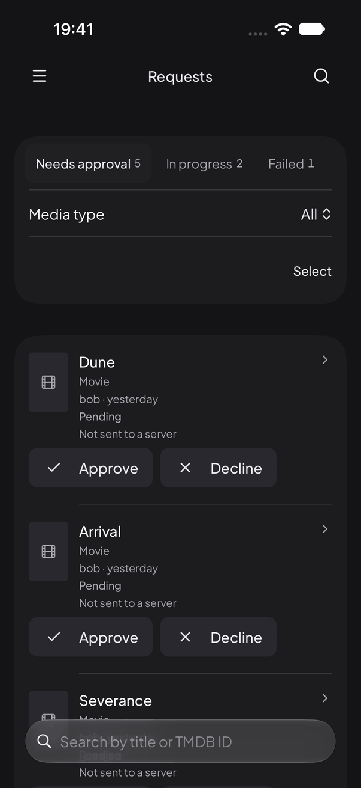
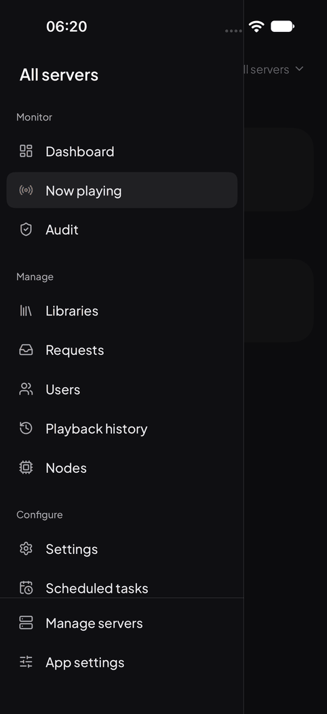
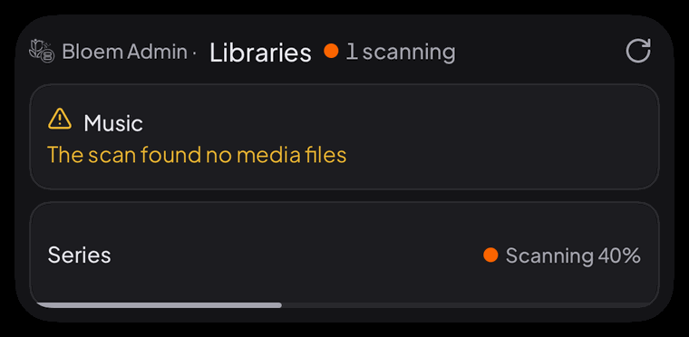

# Bloem Admin for iOS and iPadOS

> [!CAUTION]
> **Offered without support.** Bloem Admin is provided as-is, with no support of any kind. Issues are turned off, questions go unanswered, and pull requests are not accepted: they are closed without review. You are free to fork it under the AGPL v3.

Bloem Admin is a native SwiftUI app for iPhone and iPad for people who run a media server. It looks after one or more
[Silo](https://siloserver.org) servers from a phone or tablet: watch and control live streams, review playback history,
run and schedule background jobs, handle media requests, manage users, sessions and devices, read the audit and
application logs, manage libraries, nodes, plugins and backups, change settings and restart the server.

It works with **any Silo server**. When the server it is connected to is a Bloem server, the extras that only a Bloem
server offers (organizations, platform administration, support access, push notifications) switch on by themselves. On a
plain Silo server they are simply absent. You need an administrator account on the server, reachable over HTTPS. The app
is not a media player.

| Requests | Menu | Libraries widget |
|---|---|---|
|  |  |  |

These screenshots are drawn from built-in sample data. No real server, user or library appears in them.

## Push notifications and widget wakes

**On a Silo server, push notifications and widget wakes are not available.** They work only with a Bloem server, in the
official build of the app. A Silo server's own push relay cannot reach this app, so against a Silo server you get the
app's own server-down alerts (a local check the app makes while iOS lets it run in the background) and the widgets'
periodic refresh. Settings says plainly that push is not available on that server and shows no error. A build you make
yourself, under your own Apple team, does not receive push either: the push credentials belong to the official build.
Details: [docs/platform-features.md](docs/platform-features.md).

## Using it

1. Add a server by its HTTPS address, then sign in with an administrator account: a username and password, or **Sign in
   with <provider>** for each sign-in provider the server offers to apps (it opens a browser sheet and returns to the app).
2. Open the menu to move between pages: Dashboard, Now playing, Playback history, Scheduled tasks, Requests, Users,
   Libraries, Nodes, Backups, Plugins, API keys, Audit, Logs and the server's own settings. The server dropdown in the top
   bar changes the server, or shows all of them together.
3. The foot of the menu holds **Manage servers** and **App settings**: the app lock (Face ID, Touch ID or your passcode),
   Appearance (System, Light or Dark), server alerts and push notification switches.

The [user guide](docs/user-guide.md) walks through every screen.

## Get the app

There is no App Store listing. The maintainers distribute the official build through TestFlight; a public link will be
listed here when there is one. The app needs iOS or iPadOS 17 or newer.

## Build it yourself

You need a Mac with Xcode 26.6 or newer and [XcodeGen 2.46.0](https://github.com/yonaskolb/XcodeGen/releases/tag/2.46.0).

```sh
xcodegen generate
open BloemAdmin.xcodeproj
# or, from the command line:
xcodebuild build -scheme BloemAdmin -destination 'generic/platform=iOS Simulator' CODE_SIGNING_ALLOWED=NO
xcodebuild test -scheme BloemAdmin -destination 'platform=iOS Simulator,name=iPhone 17' \
  CODE_SIGN_STYLE=Manual CODE_SIGN_IDENTITY=- DEVELOPMENT_TEAM= -only-testing:BloemAdminTests
```

A fresh clone builds with no private files. To run on a device with your own Apple Developer team, copy
`Config/Signing.example.xcconfig` to `Config/Signing.local.xcconfig` (git-ignored) and put your Team ID in it. The bundle
identifiers, the App Group and the push entitlement belong to the maintainers' team, so under your own team change them in
`project.yml` (all targets) and regenerate. Your build is then a separate app: it does not replace the official one, and it
has no push. [docs/admin-guide.md](docs/admin-guide.md) has the details, and [docs/releasing.md](docs/releasing.md) is how
the maintainers cut a TestFlight build with `scripts/testflight.sh`.

## Documentation

- [docs/user-guide.md](docs/user-guide.md): every screen, for the administrator using the app
- [docs/admin-guide.md](docs/admin-guide.md): building, signing, connecting, endpoints and troubleshooting
- [docs/platform-features.md](docs/platform-features.md): alerts, links, widgets, controls and push
- [docs/releasing.md](docs/releasing.md): how a maintainer cuts a TestFlight build
- [docs/design.md](docs/design.md): the look rules, and the push and widget rules

## Security

If you find a vulnerability, read [SECURITY.md](SECURITY.md). It is a courtesy, not a support channel.

## Licence

Bloem Admin is free software under the [GNU Affero General Public License v3.0](LICENSE). Fonts, icons and tools it
includes keep their own licences, listed in [THIRD_PARTY_NOTICES.md](THIRD_PARTY_NOTICES.md). The licence covers the code.
It does not grant any right to the Bloem name or logo.
